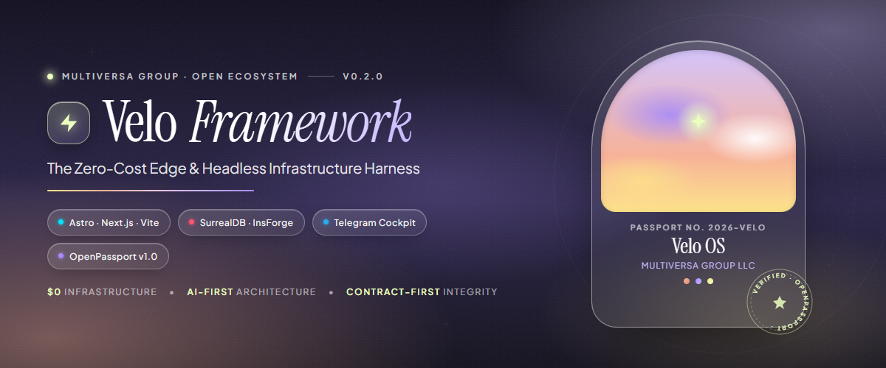

<div align="center">



<br/><br/>

[](https://github.com/moshequantum/velo/releases)
[](https://go.dev)
[](https://astro.build)
[](https://nextjs.org)
[](https://cloudflare.com)
[-FF0055?style=flat-square)](https://surrealdb.com)
[](LICENSE)

<p align="center">
  Stop wasting engineering hours wiring repetitive boilerplate. Velo packages proven edge architectures into production-ready, auditable operational harnesses designed for generous free tiers.
</p>

[Quickstart](#quickstart) • [The 4 Commandments](#the-4-commandments) • [The Production Stack](#the-production-stack) • [Unified Contract](#the-unified-contract-veloconfigts) • [CLI Reference](#cli-reference) • [Claim → Evidencia](#claim--evidencia)

</div>

---

## ⚡ Executive Summary

**Velo** is not an opinionated black-box framework. **Velo is an architectural decision packager** that unifies modern frontends ([Astro](https://astro.build), [Next.js](https://nextjs.org), or [React-Vite](https://vitejs.dev)), serverless edge compute ([Cloudflare Pages](https://pages.cloudflare.com) & Workers), and modern databases ([SurrealDB](https://surrealdb.com) as default, or [InsForge](https://insforge.app) PostgreSQL as legacy) under a Human-in-the-Loop (HITL) operational cockpit.

### Built For:
* **The Founder & Product Engineer:** Launch a robust, verifiable MVP in under 48 hours without DevOps friction, utilizing free-tier-first edge infrastructure.
* **The Consultant & Agency:** Standardize client infrastructure delivery with deterministic scaffolds, eliminating initial setup debt on every new engagement.
* **The Senior Engineer:** Transparent, standard code (*"Sin Tinta China"*). Inspect the engine, swap dependencies, and edit standard TypeScript, SurQL, and Go without framework lock-in.

---

## 📜 The 4 Commandments

1. **Sin Tinta China (No Black Magic):** Everything Velo scaffolds is standard, auditable code. If you decide to eject or replace a library, nothing breaks.
2. **AI-First & Context Grounded:** Native integration with [OpenPassport](https://github.com/moshequantum/openpassport) v1.0. LLMs receive cryptographically verified business context via deterministic SHA-256 seals, preventing hallucinations and schema drift.
3. **Secure by Default:** Constant-time token comparisons (`crypto.subtle.timingSafeEqual`), fail-closed Telegram HITL authorization gates (HTTP 503 if unconfigured, HTTP 403 on owner mismatch), and no credentials committed in `.env.example`.
4. **Free-Tier-First Architecture:** Default components are structured to run comfortably within the generous free tiers of Cloudflare (Pages/Workers) and lightweight local/remote database setups.

---

## 🏗️ The Production Stack

| Component | Technology | Role & Free Tier Capability |
|---|---|---|
| **Frontend Options** | **Astro 5** (default) / **Next.js 15** / **React-Vite** | SSR or static edge delivery via Cloudflare Pages or Workers (@opennextjs/cloudflare). |
| **Edge Runtime** | **Cloudflare Pages / Workers** | Fast global edge execution with zero server maintenance. |
| **Data & Persistence** | **SurrealDB** (default) / **InsForge** (legacy) / **None** | Multi-model database accessed via stateless HTTP client in edge runtimes; schema with `pending_action` audit table. |
| **Operational Cockpit** | **Telegram Bot API (HITL)** | Webhook endpoint `/api/telegram` with constant-time token validation and `approve:<id>` / `reject:<id>` mutation flow. |
| **Context Protocol** | **OpenPassport v1.0** | 7-layer context package verified cryptographically via canonical self-hash and LF normalization. |

---

## 🚀 Quickstart

### 1. Installation
Download pre-compiled binaries from the [Releases page](https://github.com/moshequantum/velo/releases), or build with Go:

```bash
go install github.com/moshequantum/velo/cmd/velo@latest
```

### 2. Verify Your Environment
Run the environment diagnostic tool to verify local dependencies:

```bash
velo doctor
```

```text
🩺 Diagnóstico de Entorno Velo (doctor)
--------------------------------------
  ✅ Node.js    : v26.13.0
  ✅ pnpm       : 11.1.1
  ✅ Wrangler   : 3.114.16
  ✅ SurrealDB  : 4.0.0
```

### 3. Launch the Interactive Wizard (BubbleTea TUI)
Run `velo` or `velo init` in an interactive terminal:

```bash
velo init
```

### 4. Headless / Automated Scaffolding
For CI/CD scripts or automated setups, specify flags directly:

```bash
# Preview files to generate without writing to disk
velo init --name "My Edge SaaS" --frontend astro --data surrealdb --dry-run

# Generate project directly
velo init \
  --name "My Edge SaaS" \
  --frontend astro \
  --runtime cloudflare-pages \
  --data surrealdb \
  --data-url "http://127.0.0.1:8000" \
  --cockpit telegram \
  --bot "@MySaaS_bot" \
  --target ./projects
```

### 5. Verify Context Passports
Validate any OpenPassport v1 context package against canonical SHA-256 seals:

```bash
velo verify ./path-to-passport
```

---

## 📋 The Unified Contract: `velo.config.ts`

Velo centralizes infrastructure definitions in a single TypeScript configuration file:

```typescript
// velo.config.ts — Unified Infrastructure Contract
export default {
  project: {
    name: "My Edge SaaS",
    slug: "my-edge-saas",
    version: "1.0.0"
  },
  frontend: {
    framework: "astro",         // "astro" | "next" | "react-vite"
    runtime: "cloudflare-pages" // "cloudflare-pages" | "cloudflare-workers"
  },
  baas: {
    provider: "surrealdb",      // "surrealdb" | "insforge" | "none"
    url: "http://127.0.0.1:8000"
  },
  cockpit: {
    provider: "telegram",       // "telegram" | "none"
    botHandle: "@MySaaS_bot"
  }
};
```

---

## 📂 Generated Project Anatomy (Astro + SurrealDB + Telegram)

```
my-edge-saas/
├── .dev.vars.example         # Template for Cloudflare local development variables
├── .env.example              # Sanitized environment variable template (empty secrets)
├── .gitignore                # Clean defaults for node_modules, dist, .env, .dev.vars
├── astro.config.mjs          # Cloudflare Pages adapter + Tailwind + React integrations
├── db/
│   └── schema.surql          # SurrealDB schema with SCHEMAFULL pending_action table
├── package.json              # Pinned dependencies (Astro 5, React 19, Tailwind 3.4, SurrealDB 2.2.2)
├── velo.config.ts            # The single source of truth for infrastructure
├── wrangler.toml             # Pinned compatibility_date Cloudflare runtime specification
└── src/
    ├── lib/
    │   └── db.ts             # Stateless HTTP SurrealDB client for edge workers
    └── pages/
        ├── index.astro       # High-performance edge landing page
        └── api/
            └── telegram.ts   # Fail-closed, constant-time webhook & HITL gatekeeper
```

---

## 🛠️ CLI Reference

| Command | Arguments / Flags | Exit Codes | Description |
|---|---|---|---|
| `velo` / `velo init` | — | `0` (ok), `2` (no TTY) | Launches the interactive TUI wizard. In non-interactive shells, requires `--name`. |
| `velo init [flags]` | `--name`, `--slug`, `--frontend`, `--runtime`, `--data`, `--data-url`, `--cockpit`, `--bot`, `--owner`, `--target`, `--dry-run` | `0` (ok), `1` (runtime err), `2` (invalid flag/enum) | Scaffolds harness in headless mode. Validates all inputs against strict enums. |
| `velo doctor` | — | `0` (all ok), `1` (tool missing) | Audits presence and versions of Node.js, pnpm, Wrangler, and SurrealDB. |
| `velo verify <path>` | `<path/to/dir-or-manifest.json>` | `0` (seal valid), `1` (invalid), `2` (missing arg) | Validates OpenPassport v1 cryptographic seal and individual file integrity. |
| `velo version` | `-v`, `--version` | `0` | Displays CLI version. |
| `velo help` | `-h`, `--help` | `0` | Displays full command reference and flag documentation. |

---

## 📊 Claim → Evidencia

Cada afirmación técnica del framework está respaldada por código y suites de pruebas automatizadas:

| # | Afirmación / Garantía | Implementación | Test / Verificación Automatizada |
|---|---|---|---|
| **C1** | Verificación criptográfica OpenPassport v1 determinista (`sha256(LF(replaceFirst(raw, cur, zeroes)))`) | [`pkg/manifest/manifest.go`](pkg/manifest/manifest.go) | [`pkg/manifest/manifest_test.go`](pkg/manifest/manifest_test.go) (`TestLoadAndVerify_GoldenVector`, `TestLoadAndVerify_AlteredFileFailsNamingFile`, `TestLoadAndVerify_AlteredSelfHashFails`, `TestLoadAndVerify_CRLFNormalizedSucceeds`, `TestLoadAndVerify_MissingManifestEntryFails`) |
| **C2** | Cockpit Webhook fail-closed: 503 ante secreto no configurado | [`internal/scaffold/templates/cockpit/telegram/src/pages/api/telegram.ts`](internal/scaffold/templates/cockpit/telegram/src/pages/api/telegram.ts) | [`internal/scaffold/scaffold_test.go`](internal/scaffold/scaffold_test.go) (`TestGenerate_SecurityGuarantees`) |
| **C3** | Comparación constant-time sin operadores `!==` sobre el secreto | [`internal/scaffold/templates/cockpit/telegram/src/pages/api/telegram.ts`](internal/scaffold/templates/cockpit/telegram/src/pages/api/telegram.ts) | [`internal/scaffold/scaffold_test.go`](internal/scaffold/scaffold_test.go) (`timingSafeEqual` verificado en AST/strings) |
| **C4** | Autorización estricta de dueño Telegram (`from.id == TELEGRAM_OWNER_ID` o 403) | [`internal/scaffold/templates/cockpit/telegram/src/pages/api/telegram.ts`](internal/scaffold/templates/cockpit/telegram/src/pages/api/telegram.ts) | [`internal/scaffold/scaffold_test.go`](internal/scaffold/scaffold_test.go) |
| **C5** | Cero fuga de credenciales en `.env.example` commiteable | [`internal/scaffold/templates/base/.env.example`](internal/scaffold/templates/base/.env.example) | [`internal/scaffold/scaffold_test.go`](internal/scaffold/scaffold_test.go) (asserts de claves vacías) |
| **C6** | Motor de templates componible (`embed.FS` + `text/template`) con composición en capas | [`internal/scaffold/scaffold.go`](internal/scaffold/scaffold.go) | [`internal/scaffold/snapshot_test.go`](internal/scaffold/snapshot_test.go) (4 suites de snapshot byte-idénticas) |
| **C7** | Soporte para múltiples frontends (Astro, Next.js @opennextjs, React-Vite) | [`internal/scaffold/templates/frontend/`](internal/scaffold/templates/frontend/) | [`internal/scaffold/snapshot_test.go`](internal/scaffold/snapshot_test.go) (`TestSnapshot_NextSurrealdbTelegram`, `TestSnapshot_ReactViteSurrealdbTelegram`) |
| **C8** | Proveedor SurrealDB con esquema `pending_action` y SDK HTTP en Edge | [`internal/scaffold/templates/data/surrealdb/`](internal/scaffold/templates/data/surrealdb/) | [`internal/scaffold/snapshot_test.go`](internal/scaffold/snapshot_test.go) (`TestSnapshot_AstroSurrealdbTelegram`) |
| **C9** | Validación exhaustiva de flags contra enums y códigos de salida 0 / 1 / 2 | [`cmd/velo/main.go`](cmd/velo/main.go) | [`cmd/velo/main_test.go`](cmd/velo/main_test.go) (`TestHandleInit_FlagParsingTable`) |
| **C10** | Sanitización canónica de slugs en modo headless (`--name "Mi App" → mi-app`) | [`internal/wizard/state.go`](internal/wizard/state.go) | [`cmd/velo/main_test.go`](cmd/velo/main_test.go) (`TestSlugify_Table`) |
| **C11** | Modo `--dry-run` determinista que lista archivos sin escribir en disco | [`internal/scaffold/scaffold.go`](internal/scaffold/scaffold.go) | [`cmd/velo/main_test.go`](cmd/velo/main_test.go) (`TestHandleInit_DryRunPrintsSlugPrefix`) |
| **C12** | Protección contra terminales no interactivas sin TTY | [`cmd/velo/main.go`](cmd/velo/main.go) | Integración con `mattn/go-isatty` |
| **C13** | CI multiplataforma con validación de formateo, vet y test matrix | [`.github/workflows/ci.yml`](.github/workflows/ci.yml) | Matriz GitHub Actions (`windows/amd64`, `linux/amd64`, `darwin/arm64`, `darwin/amd64`) |

---

## 📄 License

Velo Framework is open-source software licensed under the **[Apache License 2.0](LICENSE)**.

Designed and maintained by **[Multiversa Group LLC](https://multiversa.group)**.
